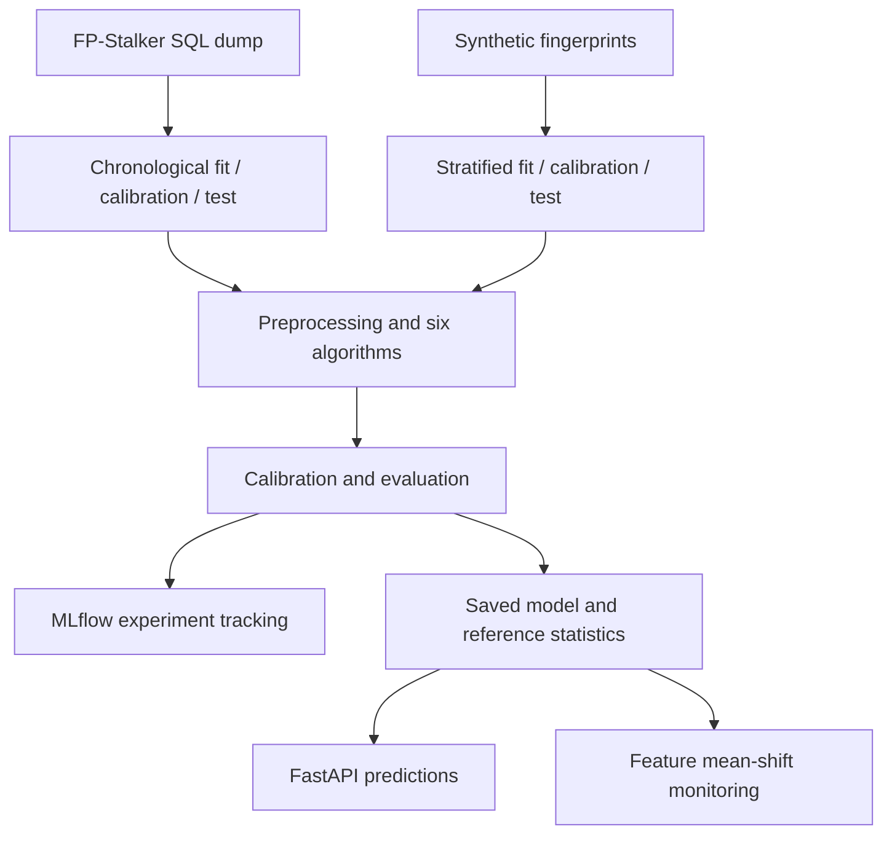
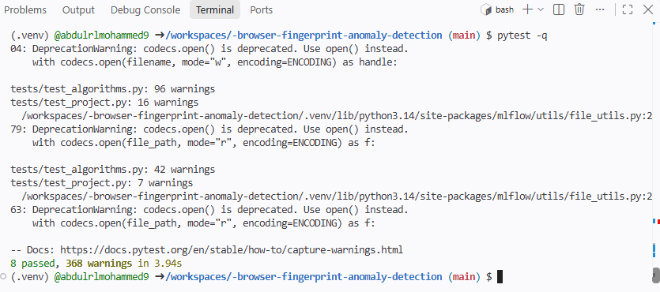
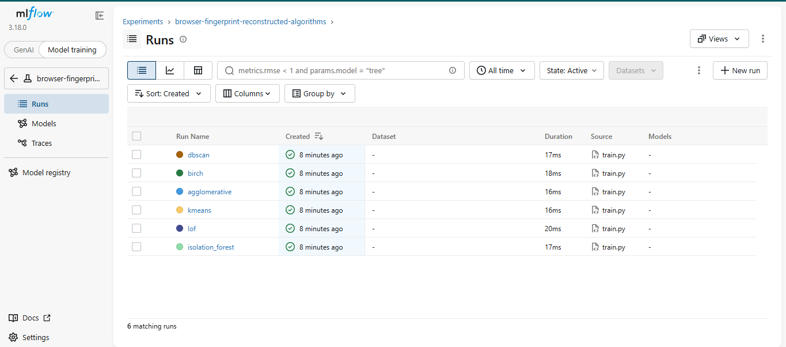
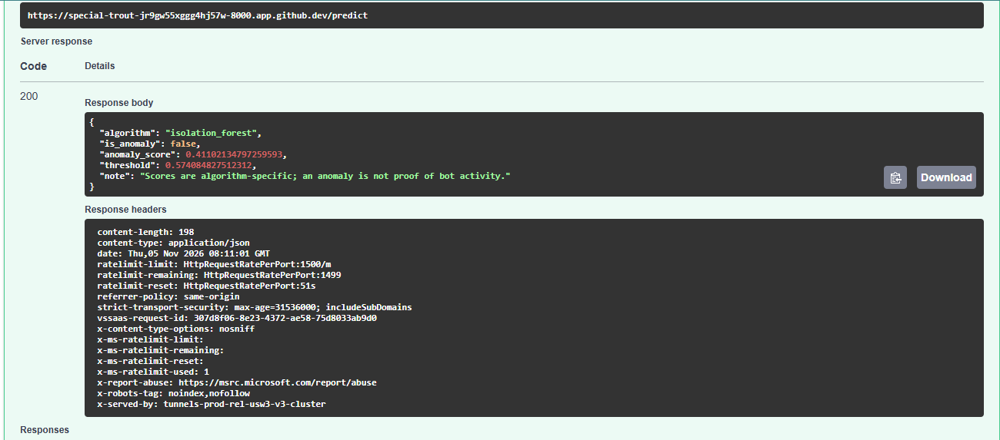
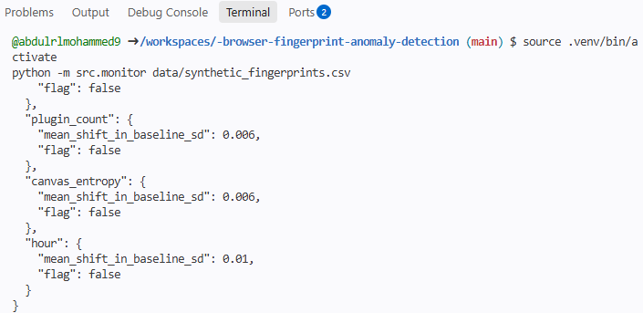

# Browser Fingerprint Anomaly Detection — MLOps Extension

An anomaly-detection MLOps project with a **synthetic labeled benchmark** and a **real, unlabeled FP-Stalker evaluation**, including MLflow tracking, inference APIs, tests, CI, basic feature-shift monitoring and a supplied Dockerfile. It is **not** the original master's implementation and **does not** establish detection of real malicious bots.

## Real public dataset: FP-Stalker
The repository now includes an SQL loader, chronological unlabeled evaluation of all six algorithms, aggregate data-quality and monitoring reports, and a separate real-data API. See the [FP-Stalker execution guide](docs/fpstalker.md).

```bash
source .venv/bin/activate
export MLFLOW_ALLOW_FILE_STORE=true
python -m src.train_fpstalker --sql data/raw/fpstalker/tableFingerprints.sql
```

This workflow preserves the synthetic benchmark. The full public-dump run is documented below. There are no verified bot labels, so no real-data F1, ROC AUC or automatic winning-model claim is made.

## Verified FP-Stalker real-data results
The downloaded public SQL dump was successfully processed in Codespaces. The checked-in [comparison JSON](docs/results/fpstalker/comparison.json), [comparison CSV](docs/results/fpstalker/comparison.csv), [data-quality report](docs/results/fpstalker/data_quality.json), and [monitoring report](docs/results/fpstalker/drift_report.json) record the run. Verification here means inspecting and reconciling those aggregate reports; it is not an independent reproduction of the raw dump or verification of anomaly labels.

### Dataset and chronological splits
- **15,000 input records**, **0 invalid timestamps**, and **61 duplicate retained records** according to the loader's retained-column comparison. Repeated observations were not automatically removed.
- **10 prepared features**: four numeric features and six categorical features. Identifiers and creation timestamps are excluded from model inputs.
- Screen width and height each have **22 missing values (0.147%)** across the full dataset. Timezone offset and plugin count have no missing numeric values under the current parser's rules; this does not independently validate their semantics.
- The source dump SHA-256 is recorded in the data-quality report for reproducibility.

| Period | Available records | Records used | Earliest creation time | Latest creation time |
|---|---:|---:|---|---|
| Fit | 8,838 | 3,000 | 2015-10-15 14:00:00 | 2016-05-12 00:00:00 |
| Calibration | 2,997 | 2,997 | 2016-05-12 02:00:00 | 2016-07-06 17:00:00 |
| Test | 3,165 | 3,165 | 2016-07-06 18:00:00 | 2016-08-31 09:00:00 |

Available split counts reconcile to 15,000. The fit period was deterministically subsampled to 3,000 records for clustering cost. Boundaries use distinct timestamps, so row proportions differ from exactly 60/20/20. Times are reproduced as stored, without assuming a timezone.

The overlap report counts **2,075 calibration rows** and **1,956 test rows** whose browser IDs appear anywhere in the available fit period. These are row counts, not unique-browser counts, and overlap is checked against the full fit period rather than only its 3,000-row training subsample. This is temporal evaluation with returning browsers, not an unseen-browser holdout.

### Alert rates
| Algorithm | Calibration alert rate | Test alert rate | Test alerts / 3,165 |
|---|---:|---:|---:|
| Isolation Forest | 7.87% | 9.19% | 291 |
| LOF | 8.01% | 20.54% | 650 |
| K-means | 7.84% | 6.64% | 210 |
| Agglomerative Clustering | 8.01% | 6.32% | 200 |
| BIRCH | 7.57% | 6.35% | 201 |
| DBSCAN | 8.01% | 6.16% | 195 |

All models target the upper 8% calibration-score tail, using a strict greater-than threshold. Tied scores and finite sample sizes can produce realized calibration rates below or slightly above 8%.

These are operational alert rates, **not accuracy, bot prevalence, precision, recall, F1 or false-positive rates**. No verified anomaly labels are available and no best model is selected. A lower alert rate does not establish a better model. Raw anomaly scores use different units across algorithms.

**LOF requires investigation:** its test alert rate rises to 20.54%, with a score median of approximately 1.237, 95th percentile of **7.94 billion**, and threshold of **6.95 million**. These finite but extreme values may reflect near-zero local distances or repeated feature vectors; that explanation is a hypothesis, not established by these reports. Inspect neighborhood distances, duplicate feature vectors and sensitivity to preprocessing/neighbors before drawing conclusions. The numeric mean-shift checks below cannot explain or rule out multivariate or categorical changes.

### Numeric monitoring
| Feature | Absolute mean shift in fit baseline SD | Test missing fraction | Flag |
|---|---:|---:|---|
| Screen width | 0.030 | 0.158% | false |
| Screen height | 0.070 | 0.158% | false |
| Timezone offset | 0.058 | 0.000% | false |
| Plugin count | 0.294 | 0.000% | false |

All four numeric shifts are below the configured threshold of greater than 1.0 baseline SD. Width and height each have five missing values in the test period. This narrow check does not establish absence of distribution drift: it does not assess categorical frequencies, local geometry, full score-distribution stability or detection performance.

### Validation scope
The complete public-dump training and aggregate reporting run is now recorded. The separate FP-Stalker API was tested with an invented SQL fixture; a live public-data API response has not yet been documented. Existing API screenshots show the synthetic model. Docker build/run and cloud deployment remain unvalidated. Synthetic metrics remain separately labeled below.


## Requirements
Python 3.11 is the package target; the demonstrated Codespaces session used Python 3.14. Installed dependency versions are recorded in [environment.txt](docs/results/environment.txt). Docker is optional. No Azure resources are required.

## Research and execution evidence
- [Original University of the Cumberlands research poster](docs/original-research/university-of-the-cumberlands-poster.pdf)
- [Research provenance and scope](docs/original-research/README.md)
- [MLOps technical report](docs/mlops-technical-report.md)
- [Raw comparison results](docs/results/comparison.csv) and [monitoring output](docs/results/drift_report.json)

## Architecture


## GitHub Codespaces quickstart
From the repository, choose **Code → Codespaces → Create codespace on main**. Run in the repository root:

```bash
python -m venv .venv
source .venv/bin/activate
python -m pip install --upgrade pip
pip install -r requirements.txt
export MLFLOW_ALLOW_FILE_STORE=true
python -m src.generate_data
python -m src.train --compare --n 5000
pytest -q
python -m src.monitor data/synthetic_fingerprints.csv
```

The environment variable enables the local file store required by the supplied code in the demonstrated MLflow 3.18.0 environment. Set it again in each new terminal that uses MLflow.

The generator writes a 5,000-row CSV for inspection and monitoring. Training independently calls the same generator internally; it does not load this CSV. With `--n 5000`, training uses 3,000 fit rows, 1,000 calibration rows and 1,000 test rows.

Open MLflow in a terminal and leave it running:
```bash
source .venv/bin/activate
export MLFLOW_ALLOW_FILE_STORE=true
mlflow ui --backend-store-uri ./mlruns --host 0.0.0.0 --port 5000
```
Open port 5000 from **Ports → Open in Browser**, choose **Model training**, then the **browser-fingerprint-reconstructed-algorithms** experiment and **Runs**.

In a separate terminal, start the API:
```bash
source .venv/bin/activate
uvicorn src.api:app --host 0.0.0.0 --port 8000
```
Open port 8000 through the Ports tab and append `/docs` to the actual forwarded URL. The root `/` and `/dev` have no route and return 404. In Swagger, use **POST /predict → Try it out → Execute** with the example below. Keep forwarded services private.

## Recorded synthetic benchmark
| Algorithm | Precision | Recall | F1 | Average precision | ROC AUC | False-positive rate |
|---|---:|---:|---:|---:|---:|---:|
| Isolation Forest | 0.696 | 0.714 | 0.705 | 0.837 | 0.978 | 0.026 |
| LOF | 0.051 | 0.052 | 0.051 | 0.076 | 0.375 | 0.081 |
| K-means | 0.174 | 0.195 | 0.184 | 0.177 | 0.534 | 0.077 |
| Agglomerative | 0.203 | 0.182 | 0.192 | 0.145 | 0.530 | 0.060 |
| BIRCH | 0.141 | 0.169 | 0.154 | 0.095 | 0.476 | 0.086 |
| DBSCAN | 0.200 | 0.208 | 0.204 | 0.222 | 0.400 | 0.069 |

Values are rounded to three decimals; false-positive rate is a fraction (0.026 ≈ 2.6%). Isolation Forest had the highest average precision in this run. The selection uses the same test set, so these are exploratory synthetic results, not an unbiased estimate for the selected model or evidence of real bot detection.

## Synthetic execution screenshots
The Codespaces session demonstrated eight passing tests, MLflow runs, a successful API response and monitoring. These are captured session results, not a claim that every environment or Docker build has been validated.

### Tests


### MLflow


### API prediction


### Monitoring



## Windows PowerShell quickstart
```powershell
py -3.11 -m venv .venv
.\.venv\Scripts\Activate.ps1
python -m pip install -r requirements.txt
$env:MLFLOW_ALLOW_FILE_STORE = "true"
python -m src.generate_data
python -m src.train
pytest -q
uvicorn src.api:app --reload
```

Visit http://127.0.0.1:8000/docs and try POST `/predict`.

## Example request
```json
{"screen_width":1920,"screen_height":1080,"plugin_count":5,"canvas_entropy":0.5,"hour":12,"ua_family":"Chrome"}
```

## MLflow local UI
In another terminal from the repository root:
```powershell
$env:MLFLOW_ALLOW_FILE_STORE = "true"
mlflow ui --backend-store-uri ./mlruns --port 5000
```
Visit http://127.0.0.1:5000 .

## Monitor a recent batch
```powershell
python -m src.monitor data/synthetic_fingerprints.csv
```
Reports mean feature shift in units of baseline standard deviations; **not** a validated concept-drift or statistical significance test.

## Docker
The Dockerfile is supplied; a successful Docker build/run has not been demonstrated in the saved evidence. Train before building (the ignored local `artifacts/` folder must exist):
```powershell
docker build -t fingerprint-api .
docker run --rm -p 8000:8000 fingerprint-api
```

## Adaptation to the actual research
Replace `src/generate_data.py` with a permissioned original dataset loader; preserve the original schema and preprocessing, document provenance and privacy treatment, avoid direct identifiers, reproduce reported results, evaluate temporal splits and bias, and only then consider an Azure deployment.

## Limitations
- Synthetic labels were created for benchmarking and do not represent real bot ground truth.
- `joblib.load` loads Python objects: use only trusted artifacts.
- No authentication, rate limits or production security hardening.
- This is a starter CI workflow, not continuous deployment.
- Cloud deployment/IaC are future extensions, not included as working deployments.
- Unsupervised anomaly != confirmed bot.

## Reconstructed multi-algorithm benchmark (new)

The original research code and dataset were lost. This extension **reimplements**
the approaches named in the master's poster, not their original fitted models,
parameter selections, experimental results or data. Available algorithms:

- Isolation Forest: inverse isolation score
- Local Outlier Factor (LOF): novelty-mode inverse local density score
- K-means: distance to closest centroid
- Agglomerative Clustering: distance to nearest *training-cluster centroid*
- BIRCH: distance to nearest *training-cluster centroid*
- DBSCAN: distance to nearest DBSCAN core sample; if no cores, nearest training point fallback

For fairer anomaly flagging, all algorithms use a **separate unlabeled calibration
subset** and flag scores strictly above the 92nd percentile (8% expected alert
rate). Scores have different units; **do not compare raw scores across models**.
Labels are reserved for synthetic evaluation. The synthetic train/calibration/test split
is 60%/20%/20%, stratified using simulated labels for test stability. A real
study should use chronological splits and not rely on synthetic-label
stratification.

```powershell
# Compare all algorithms and write artifacts/comparison.csv and comparison.json
python -m src.train --compare

# Train and serve only a specific algorithm (example: LOF)
python -m src.train --algorithm lof
uvicorn src.api:app --reload
```

`/predict` returns the selected algorithm, its algorithm-specific anomaly score,
threshold and an anomaly indicator. A comparison run selects the highest
**synthetic test-set average precision** for demonstration purposes only; that
winner-selection procedure biases its reported performance. Validate on a
fresh, independent holdout before making any real-world performance claim.

### Important method limitations

Agglomerative Clustering and DBSCAN do not intrinsically support out-of-sample
prediction. The saved centroid/core-neighbor distance strategies are explicit
engineering approximations, **not** their original clustering labels.
Likewise, anomaly scores from K-means and BIRCH measure proximity to clusters,
not maliciousness. DBSCAN's `eps` is a baseline guess and must be tuned to the
feature space and data scale. K-means and BIRCH assume cluster geometry that
may not suit browser fingerprint distributions. PCA and t-SNE were mentioned
in the poster but are not part of this new benchmark; t-SNE particularly
should not be treated as an ordinary out-of-sample production transform.

This package is **not a faithful reproduction of the original master's
experiments** and cannot substantiate its reported 0.5% false-positive rate or
real-world bot-detection performance.
